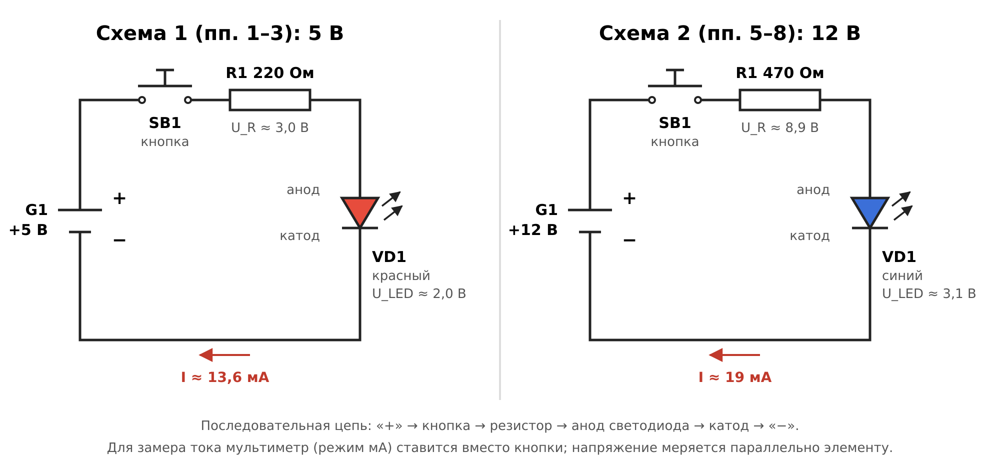
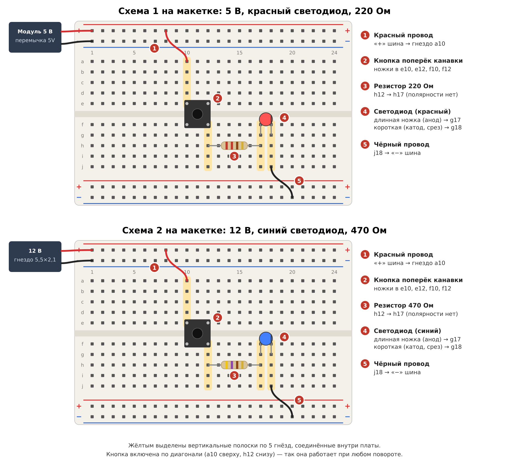

# Занятие 1. Напряжение и ток. Схемотехника

Простейшие цепи «источник → кнопка → резистор → светодиод»: сборка на макетной плате, измерения мультиметром, пайка на монтажной плате с питанием через винтовой терминал KF128 и демонтаж.

Полный отчёт: [report.docx](report.docx)

## Схемы

## Результаты измерений

| Цепь | U питания | U на светодиоде | U на резисторе* | I измеренный | I расчётный | Отклонение |
|---|---|---|---|---|---|---|
| 5 В, красный LED, 220 Ом | 5,00 В | 1,98 В | 3,02 В | 13,6 мА | 13,7 мА | 0,7 % |
| 12 В, синий LED, 470 Ом | 12,00 В | 3,05 В | 8,95 В | 19,3 мА | 19,0 мА | 1,4 % |

\* U_R = U_пит − U_LED (второе правило Кирхгофа).

## Материалы

| Файл | Что на нём |
|---|---|
| [photos/5v-red-led-voltage-1.98V.jpg](photos/5v-red-led-voltage-1.98V.jpg) | Напряжение на красном светодиоде, 5 В |
| [photos/5v-red-current-13.6mA.jpg](photos/5v-red-current-13.6mA.jpg) | Ток в цепи 5 В |
| [photos/12v-blue-led-voltage-3.05V.jpg](photos/12v-blue-led-voltage-3.05V.jpg) | Напряжение на синем светодиоде, 12 В |
| [photos/12v-blue-current-19.3mA.jpg](photos/12v-blue-current-19.3mA.jpg) | Ток в цепи 12 В |
| [photos/desoldering-result.jpg](photos/desoldering-result.jpg) | Монтажная плата после демонтажа |
| [video/5v-red-led.mov](video/5v-red-led.mov) | Работа цепи 5 В на макетке |
| [video/12v-blue-led.mov](video/12v-blue-led.mov) | Работа цепи 12 В на макетке |
| [video/soldered-board-kf128.mov](video/soldered-board-kf128.mov) | Спаянная плата с питанием через KF128 |
