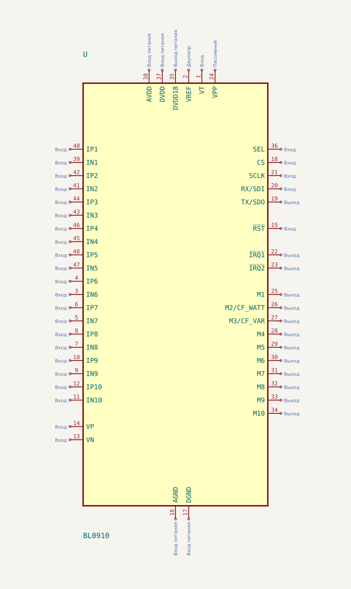
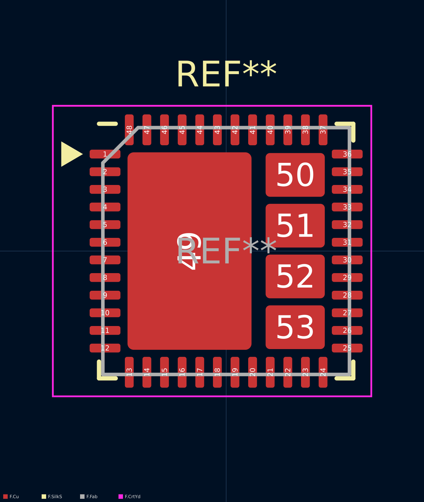

# Занятие 2. Символы и посадочные места в KiCad

Библиотечные символы и посадочные места для BL0910, XS2184, HLK-7628N и AW9523BTQR (KiCad 10).

- Отчёт: [Отчет_ДЗ2_Латушков.pdf](Отчет_ДЗ2_Латушков.pdf) / [.docx](Отчет_ДЗ2_Латушков.docx)
- Проект KiCad: [HW2_KiCad/](HW2_KiCad) — открыть `HW2.kicad_pro`, библиотеки подключаются автоматически
- Архив для сдачи: [HW2_KiCad.zip](HW2_KiCad.zip)

| Компонент | Символ | Посадочное место |
|---|---|---|
| BL0910 | `HW2_Symbols:BL0910` | `BL0910_LQFP-48_7x7mm_P0.5mm` (на основе стандартного LQFP-48) |
| XS2184 | `HW2_Symbols:XS2184` | `XS2184_QFN-48-5EP_7x7mm_P0.5mm` (разработано по даташиту) |
| HLK-7628N | `HW2_Symbols:HLK-7628N` | `HLK-7628N_Module_35.5x18.7mm` (разработано по даташиту) |
| AW9523BTQR | `HW2_Symbols:AW9523BTQR` | `AW9523BTQR_TQFN-24-1EP_4x4mm_P0.5mm_EP2.7x2.7mm` (на основе стандартного QFN-24) |

